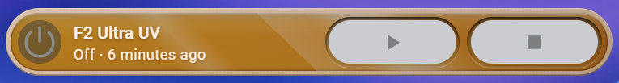
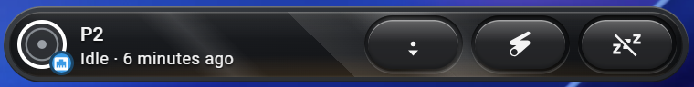
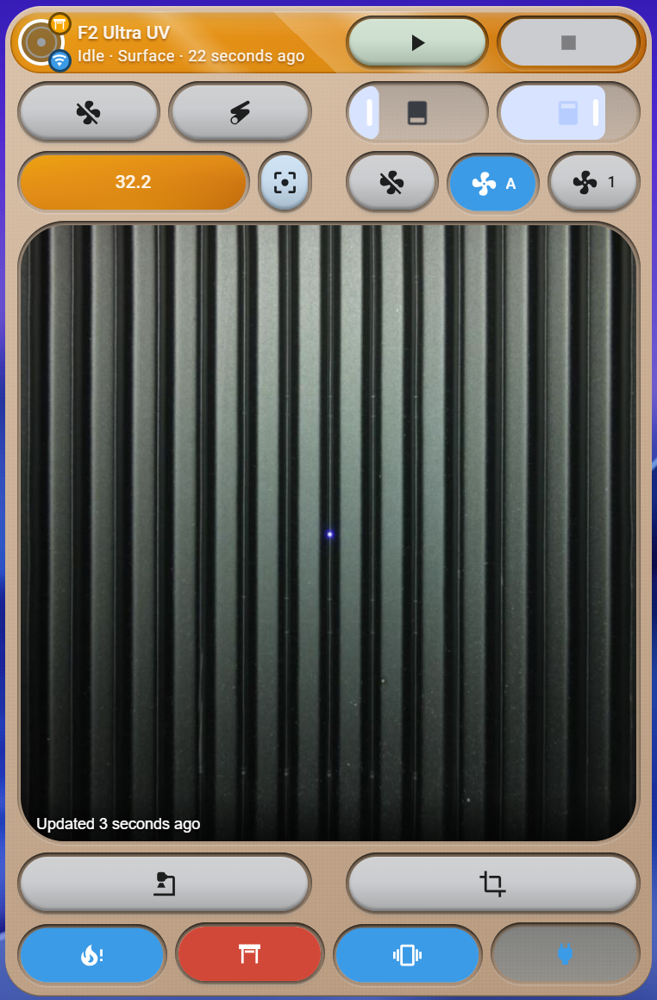
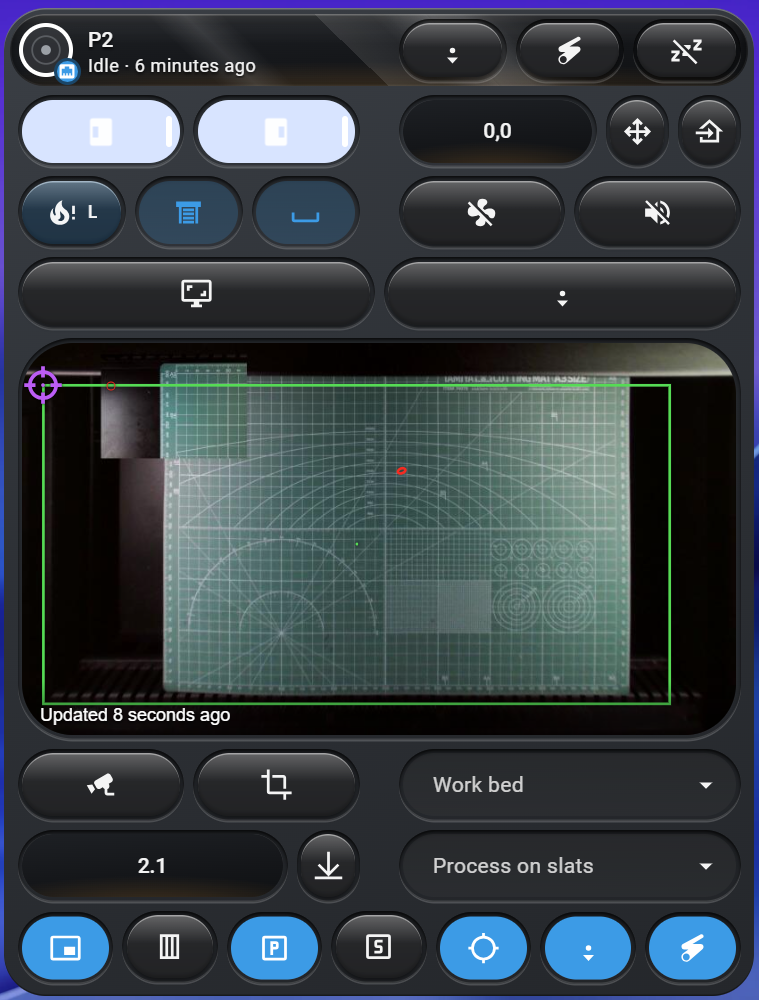

# xTool Card

A Home Assistant dashboard card for xTool lasers. It is Home Assistant's own **tile card**, wrapped: the card builds a tile card for the laser's Status sensor and adds to it. Everything a tile card does works the same way, with the same editor: name, icon, state content, interactions, features and layout. The card layers on top:

- **A state picture** of the laser in place of the icon, with a **status badge**, a **connection badge** and a **status light** ring that copies the laser's own light.
- **A progress edge** that fills along the card while a job runs.
- **xTool styles** that paint the card in the colors of the laser's body and window. A new card gets its laser model's style.
- **Collapsing** to the title row with a tap, and following the laser's power.
- **xTool features**, added like any tile feature: Job, Controls, Configuration, Safety, Lights, Camera, Overlays, Position, Focus and SafetyPro IF2 fan.

The card needs the [xTool Laser integration](https://github.com/thecodingdad/ha-xtool) for the entities it shows and controls.

| F2 Ultra UV | P2 |
| --- | --- |
|  |  |
|  |  |

> [!WARNING]
> **Alpha developmental software. Use with caution.** This card can expose controls for xTool machines. Check every control and entity on your machine before relying on it, and keep the manufacturer's safety procedures in place.

## Status

This card is in **Alpha** and is being developed alongside the xTool Laser integration. It is not yet a stable, broadly validated release.

The current release is **0.1.0-alpha.1**. Alpha releases use SemVer prerelease
versions; later Alpha releases increment the final prerelease number.

- **Developed with:**
  - xTool F2 Ultra UV
  - xTool P2
- **Hardware-tested:**
  - xTool F2 Ultra UV
  - P2 basic controls
- **In development:**
  - P2 advanced controls
- **Other machines:**
  - The card may work where the integration exposes the expected entities. Please share what you find in [Discussions](https://github.com/GizmoGoody/xtool-card/discussions), and feel free to submit pull requests.

## Install

Home Assistant 2026.11 and later include the Marketplace, which replaces HACS. The card needs a Home Assistant version with the Marketplace, or HACS on an older one.

1. Go to **Settings** → **Marketplace**. On the first visit, select **I understand the risks and agree**.
2. In the upper-right corner, select **Add from link**, enter `GizmoGoody/xtool-card` under **GitHub link**, and select **Add**. If asked for the type, choose the dashboard type.
3. Open **xTool Card** and select **Install**, then **Install** again in the dialog. This installs the latest release.
4. Reload the browser page (in the Companion app, pull down to refresh).

The Marketplace adds the card to **Settings** → **Dashboards** → **Resources** for you. To add the card, edit a dashboard, select **Add card**, and search for **xTool**.

Adding a repository from a link needs a connection to GitHub, which the Marketplace asks for the first time. With HACS on an older Home Assistant, use ⋮ → **Custom repositories**, add `GizmoGoody/xtool-card` with the type **Dashboard**, then select **Download**.

## Styles

The card's **Style** option draws the tile in the colors of an xTool machine. The editor has a style for each model, and for each color a model is sold in; a new card starts with its laser's model's style. [xTool Machine Colors](https://gizmogoody.github.io/xtool-card/colorways.html) shows every style's colors beside the xTool photos they come from.

## Configuration

Add the card from the dashboard editor: select **Add card** and search for **xTool**. The editor shows the tile card's own options, then the card's. The YAML below is a small example; the editor saves only the options that differ from their defaults.

```yaml
type: custom:xtool-card
entity: sensor.f2_ultra_uv_status
features:
  - type: custom:xtool-job
  - type: custom:xtool-camera
    full_width: true
```

### Card options

Every tile card option works as it does on a tile card. The card changes the defaults of these:

| Tile card option | Default on this card |
| --- | --- |
| `name` | The laser's device name (`type: device`) |
| `features_position` | `inline`: the features sit beside the title |
| `state_content` | The state, the engraving lens (on a laser that has one) and the time the job has run |
| `show_entity_picture` | Always on: the state picture is shown in place of the icon |

The card adds these options:

| Option | Type | Default | Description |
| --- | --- | --- | --- |
| `entity` | entity | Required | The laser's Status sensor. In the editor, choose the **Laser** and the card finds it. |
| `style` | string | The laser model's style | The xTool style, by its id (see [xTool Machine Colors](https://gizmogoody.github.io/xtool-card/colorways.html)), or `none` to follow your theme. |
| `features_style` | `match`, `flat`, `console` | `console` | How the features sit on a styled card: on the body, on a plain patch of the body's color, or in a channel pressed into the body. |
| `enabled_color` | color | `info` | The color of keys that are on, and of sliders. Job keys and safety warnings keep their own colors. |
| `pattern` | number | `4242` | Where the reflections fall on a styled card's window. **Randomize reflections** in the editor picks a new one. |
| `collapsible` | boolean | `true` | A tap on the card shows or hides its features, in place of the card's tap action. A tap on the icon still works as set. |
| `expanded_at_load` | boolean | `false` | A collapsible card starts expanded. After a tap, the browser remembers the choice. |
| `expand_when_powered_on` | boolean | `true` | A collapsible card expands when the laser turns on. |
| `collapse_when_powered_off` | boolean | `true` | A collapsible card collapses when the laser turns off. |
| `last_feature_full_width` | boolean | `true` | With the features beside the title, a last feature alone in its row stretches across both columns. |
| `status_badge` | list | `alarm`, `safety_key`, `lid`, `safety_checks` | The badge at the top right of the picture. When several apply, the first in the list shows. Also offered: `firmware`. Only the ones the laser has are used. |
| `connection_badge` | boolean | `true` | A badge at the bottom right of the picture: Ethernet, Wi-Fi or USB, or that the laser is unavailable. |
| `status_light` | boolean | `true` | A thin ring around the picture in the color and pattern of the laser's own status light. |
| `progress_edge` | map | See below | The bar that fills along the card while a job runs. |
| `overlay_styles` | map | The integration's | How the card draws each camera overlay, by the overlay's name: `color`, `line`, `style` (`solid`, `dashed`, `dotted`), `icon` and `size` (px), as each overlay allows. |

`progress_edge` options:

| Option | Default | Description |
| --- | --- | --- |
| `edge` | `top` | `none`, `top`, `bottom`, `left`, `right` or `around` (around the card). |
| `thickness` | `4` | The bar's thickness in pixels, 1 to 24. |
| `starts_at`, `ends_at` | `0`, `100` | Where along the edge the bar starts and ends, in percent. |
| `direction` | `clockwise` | `clockwise` or `counterclockwise`. |
| `color` | `state` | `state` follows the laser's state (its working color, amber when paused, green when finished). `thresholds` is green above 60 %, amber above 20 % and red below. Or any color. |
| `show_percentage` | `false` | Shows the job's percentage. |
| `show_while` | `processing`, `paused` | When the bar shows: `processing`, `paused`, `framing`, `finished` and `error`. |

### Features

Add them like any tile feature, under **Features** in the editor. Only the features the laser has entities for are offered. Each has a `controls` list of the keys it shows; the editor lists the ones the laser has.

| Feature | Type | What it shows |
| --- | --- | --- |
| Job | `custom:xtool-job` | Start, pause and cancel the job. |
| Controls | `custom:xtool-controls` | Power, fans, fill lights, red dots, safety lock, wake, buzzer and sleep. |
| Configuration | `custom:xtool-configuration` | The same keys for the laser's configuration entities. |
| Safety | `custom:xtool-safety` | Flame alarm, the stop when opened or moved checks, safety key, lid, baseplate and access control. |
| Lights | `custom:xtool-lights` | The fill lights with their brightness. |
| Camera | `custom:xtool-camera` | The camera picture with its controls: camera switch, crop, perspective, fill lights and more. Options: `camera`, `camera_view` (`auto` or `live`), `show_last_updated` (`true`) and `full_width` (`true`). |
| Overlays | `custom:xtool-overlays` | The camera overlay switches. |
| Position | `custom:xtool-position` | The laser head position, Move laser and Home laser. |
| Focus | `custom:xtool-focus` | Autofocus and the focus height. |
| SafetyPro IF2 fan | `custom:xtool-safetypro-if2-fan` | Off, Auto and the fan speed. |

## The xTool Laser integration

The card reads and controls the entities of the [xTool Laser integration](https://github.com/thecodingdad/ha-xtool). Install it from the Marketplace (or HACS) as its README describes.

Its latest release, **v2.8.0** (November 3, 2026), has the laser's Status sensor and its basic entities, so the card works with it. The editor offers only the features a laser has the entities for, so some features do not appear yet. Most of what the pictures above show needs integration changes that are in open pull requests. All of them were opened between November 8 and 14, 2026, and none has been reviewed yet.

| Pull request | What it brings to the card | Depends on |
| --- | --- | --- |
| [#71 IF2 2.0](https://github.com/thecodingdad/ha-xtool/pull/71) | The SafetyPro IF2 fan feature: Off, Auto and speeds 1 to 4 | |
| [#52 Hold written values](https://github.com/thecodingdad/ha-xtool/pull/52) | Keys that stay as tapped, instead of flipping back until the next poll | #71 |
| [#70 F2 Ultra UV](https://github.com/thecodingdad/ha-xtool/pull/70) | Focusing and Warming up in the status, the engraving lens, the exhaust fan and red dot, and the Focus feature | |
| [#73 WS-V2 cameras](https://github.com/thecodingdad/ha-xtool/pull/73) | A faster camera picture, and how often it refreshes | |
| [#74 F2 Ultra UV cameras](https://github.com/thecodingdad/ha-xtool/pull/74) | Straightened pictures, a device per camera, Crop and Perspective, and the Calibration image | #70, #73 |
| [#69 WS-V2 fixes](https://github.com/thecodingdad/ha-xtool/pull/69) | Failed jobs shown as failed, and a sleeping laser left alone | |
| [#60 P2](https://github.com/thecodingdad/ha-xtool/pull/60) | Everything for the P2: status, cameras, crop presets, overlays, Position, lights, safety and the Connection sensor | #52, #69, #73, #74 |
| [#72 Power switch](https://github.com/thecodingdad/ha-xtool/pull/72) | Initializing while the laser starts, readings unavailable while it is off, and auto power-off | |
| [#68 Small fixes](https://github.com/thecodingdad/ha-xtool/pull/68) | Fill light brightness as in xTool Studio, and tidier device pages | |
| [#55 Access control](https://github.com/thecodingdad/ha-xtool/pull/55) | The Access control switch, named as in xTool Studio and only on the units that have it | |

Each pull request with a dependency contains the commits of the ones it depends on, so they can be merged in this order: #71, then #52; #70 and #73, then #74; #69; then #60. The others can be merged at any time.

Some changes the card uses are not in a pull request yet. They will be offered after the ones above are merged:

- The places of the P2 overlays and the area each camera shows, which let the card draw the overlays in its own **Overlay styles**.
- The F2 Ultra UV Connection sensor, which the connection badge shows (Wi-Fi or USB).

## Troubleshooting

### The card shows "Custom element does not exist"

- Check that **Settings** → **Dashboards** → **Resources** lists the card as a JavaScript module. The Marketplace adds it when you install the card.
- Reload the browser page once. A dashboard opened before the card was available can keep showing the error until then.
- If your dashboard resources are defined in YAML (`lovelace:` `resource_mode: yaml`), the Marketplace cannot add the resource. Add this instead:

  ```yaml
  lovelace:
    resources:
      - url: /hacsfiles/xtool-card/xtool-card.js
        type: module
  ```

## Development

The browser tests use the stand-ins in `tests/card` and can be run with:

```text
python tests/card/run_card_tests.py
```

Set `CHROME` to a Chromium-based browser executable when it is not on `PATH`.

## License

MIT. See [LICENSE](LICENSE).
